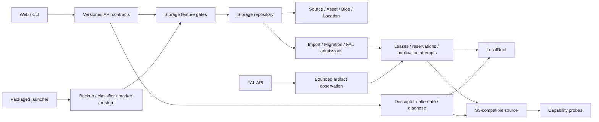
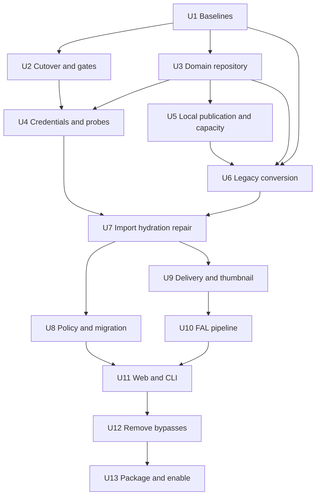

# Flexible Local and S3 Image Storage Implementation Plan

## Summary

Replace Titles DAM’s implicit local hydration model with a source-bound storage contract that can retain image originals on Local storage or S3-compatible storage, including MEGA S4. Deliver the change as one compatibility release: migrate existing databases and callers, keep every new producer behind durable readiness gates, and remove legacy URL, source-selection, job, and direct-location paths before enablement.

The normative behavior is defined in `docs/superpowers/specs/2026-07-10-flexible-image-storage-design.md`. This plan sequences that design into independently testable build units without weakening its atomic rollout requirement.

## Problem Frame

Titles DAM already catalogs MEGA S4 without downloading large model artifacts, but image content, thumbnails, and FAL outputs still assume hydrated local files. Current rows identify S3 locations with mutable strings, workers reconstruct clients from global configuration, image callers build synchronous local URLs, and startup creates schema from live SQLAlchemy metadata. Those shortcuts cannot safely support direct S3 image delivery, storage-policy changes, source recovery, or crash-safe migration.

The implementation must preserve byte-level provenance while allowing one image revision to have several verified physical locations. A source outage, credential rotation, stale worker, canceled migration, browser-native image failure, or interrupted database cutover must produce a deterministic state rather than silently selecting a different account or byte sequence.

## Scope Boundaries

### In scope

- Local or named S3-compatible storage policy for new image originals and generated FAL outputs.
- MEGA S4 as a normal S3-compatible source, subject to measured provider capabilities.
- Immutable source identity, immutable image revisions, verified content blobs, and multiple physical locations.
- Source-bound import, hydration, refresh, repair, migration, delivery, thumbnail, and FAL workflows.
- Direct exact-version S3 delivery where safe; conditional proxy/spool fallback otherwise.
- Frozen legacy schema baselines, installed-database conversion, encrypted raw/sanitized backups, journaled recovery, and readiness gates.
- Unified two-step FAL admission for prompt Evals and grids.
- Complete web and CLI caller migration, including accessibility and recovery states.

### Out of scope

- Moving SQLite application state to S3.
- Multi-user authentication, LAN/public serving, reverse-proxy support, or shared-host isolation.
- Automatic deletion of verified Local or S3 copies.
- Multipart managed uploads in this release.
- A generic cloud-storage abstraction beyond Local and S3-compatible providers.
- Provider-side FAL checkpoint preflight for adapters that do not expose one.
- Mobile editing redesign or new collaboration behavior.

## Requirements

### Storage identity and provenance

- R1. Represent every configured S3 source with an immutable canonical fingerprint and a named credential environment; identity changes create a replacement source.
- R2. Treat each `Asset` as an immutable image revision; changed source bytes create a new Asset rather than mutating historical identity.
- R3. Attach a `ContentBlob` only after one-time byte verification, and reuse it only on exact SHA/size agreement.
- R4. Permit several verified `AssetLocation` rows per revision while recording one exact preferred location and deterministic same-blob fallback order.
- R5. Bind TrainingRun, CheckpointRevision, ModelVersion, EvalRun, Sample, EvalOutput, import, migration, hydration, delivery, and FAL handoff to explicit source/location/revision snapshots.

### Storage backends and transfer safety

- R6. Persist immutable Local roots with descriptor-relative, no-follow, owner/mode/device-safe operations and crash-safe publication ordering.
- R7. Persist transfer, publication-attempt, receipt, cleanup, lease, reservation, and fence records before external I/O; stale attempts never publish database state.
- R8. Probe write, conditional-read, versioned-read, cleanup, and FAL-handoff capabilities against the exact source/credential epoch and expire positive results.
- R9. Use create-only, private, single-Put managed S3 writes with verified read-back; never issue an unqualified delete.
- R10. Enforce global, per-source, root, filesystem-headroom, temporary-spool, proxy, thumbnail-cache, and FAL-output limits before I/O or billing.

### Policy, import, migration, and recovery

- R11. Expose a versioned Local/S3 `StoragePolicyV1` with timing-independent automatic selection and explicit FAL Local fallback.
- R12. Split import into versioned preview/admission and explicit Keep-at-origin or Copy-to-this-computer effects; basic-read-only sources cannot Keep.
- R13. Freeze import inventory, source fingerprint, capability mode, destination root, and capacity before admitted work; continuation processes only the frozen remainder.
- R14. Provide SQL-defined, versioned storage migration preview/admit/detail/actions with exact scope, destination, counts, progress, history, controls, focus, and 200/202/409 unions.
- R15. Serialize migration execution per workspace with `MigrationExecutionOwner`; owner epochs fence every child transfer through final commit and replacement/abandon revokes predecessor commits.
- R16. Provide typed asset/source/root repair and pre-admission return-draft flows without allowing admitted work to rewrite frozen identity or policy.

### Image delivery and cache

- R17. Replace every legacy image URL with closed delivery, alternate, diagnose, and `AssetImageV1` contracts keyed by `Asset.id` as `asset_revision_id`.
- R18. Presign only exact versioned reads; conditionally proxy immutable unversioned bytes and spool/hash when the provider cannot enforce a condition.
- R19. Bound remote source fetch, decode memory/dimensions, derivative size, proxy bytes, concurrency, and capability lifetime.
- R20. Account thumbnail source/temp/output and foreign bytes in a registered cache-root capacity domain with deterministic unleased LRU eviction.
- R21. Preserve the canonical image-detail route, `StorageDetails`, shared Retry/alternate state machine, persistent detail anchor, live-region batching, and exact focus behavior across all eight image surfaces.

### FAL generation

- R22. Replace direct Eval/grid provider POSTs with one versioned, discriminated `FalAdmissionV1` create/review/admit flow.
- R23. Freeze endpoint adapter/version, normalized parameters, model/checkpoint revision, prompt/grid inputs, exact subjects, expected ordinals/counts, storage policy, handoff assurance, spool root, and capacity before billing.
- R24. Require exact locally-verified billing-risk acknowledgement for current adapters; use provider-verified mode only where a documented non-billable provider preflight exists.
- R25. Persist at-most-once submission intents and durably observe, hash, identify, transfer, and link every generated artifact before creating EvalOutput.
- R26. Support same-request nonbillable recovery and explicit selected-subject billable retry without cloning stale payloads or losing partial committed outputs.

### Security, compatibility, and rollout

- R27. Enforce the trusted loopback no-auth ingress contract with raw-peer, exact Host/Origin, and Forwarded-header checks; use source-scoped hardened outbound transports with public actual-peer validation, no ambient credentials/proxies, bounded typed bodies, and structural redaction.
- R28. Replace runtime installed-database `create_all` with frozen empty/unversioned/0001/0002 baselines, an authoritative 0003 migration, exact classifiers, and immutable fixtures.
- R29. Require launcher-owned cutover/run locks, encrypted raw and sanitized backups, main/WAL/SHM database-set restore journals, marker/binding receipts, and pre-enable/no-effect sanitized rollback.
- R30. Transition `storage_contract` and every dependent gate only from immutable verification receipts; ship schema, repositories, workers, APIs, web/CLI callers, removals, tests, and enablement in one compatibility artifact.

## Key Technical Decisions

- KTD1. Asset identity is revision identity: `Asset.id` is the only browser/server `asset_revision_id`. There is no second mutable AssetRevision entity.
- KTD2. Physical location is separate from content identity: an Asset may gain verified copies without changing historical references.
- KTD3. Exact provider behavior is measured, not inferred from a vendor name. MEGA S4 receives no privileged compatibility branch.
- KTD4. Source clients are created only from immutable source rows and named credential epochs. Global/default boto3 credentials are prohibited for source-bound operations.
- KTD5. Every external write has a unique attempt key and durable publication intent/receipt. Reclaimed work never reuses the old physical target.
- KTD6. SQLite critical sections use short `BEGIN IMMEDIATE` compare-and-swap transactions. Network and filesystem I/O stay outside those transactions.
- KTD7. Migration ownership is an additional transfer commit fence, not merely an API admission lock.
- KTD8. Local publication uses descriptor-relative file descriptors and directory fsync. Path normalization alone is insufficient.
- KTD9. Thumbnail cache is a capacity domain, not an unbounded convenience directory.
- KTD10. The browser receives a descriptor and a closed recovery action, not a URL-construction convention.
- KTD11. FAL prompt Evals and grids share one admission resource. Existing direct submit routes are removed rather than wrapped.
- KTD12. Current FAL adapters use locally verified checkpoint handoff plus an exact billing acknowledgement because no non-billable provider fetch preflight exists.
- KTD13. The compatibility release is built incrementally behind disabled gates but deployed as one artifact. No old binary may coexist after marker commit.
- KTD14. Sanitized rollback is allowed only before `storage_contract` enablement and before any post-marker external effect. Later recovery must preserve current intent/receipt lineage rather than rolling back to cutover time.
- KTD15. Database restore replaces SQLite main, WAL, and SHM as a journaled set. Startup examines external recovery journals before opening SQLite.

## High-Level Technical Design

### Control-plane sequence

1. The launcher owns the installation lock and database cutover/restore journals.
2. Migration establishes schema, scrubs legacy state, writes sanitized backup, and commits marker/binding with all gates disabled.
3. `titles storage verify-contract` records the foundational receipt and makes only `storage_contract` ready.
4. Each dependent verifier records evidence tied to the current foundational receipt before enabling its gate.
5. Producers check gates before persistence. Workers check marker, receipt, gate, snapshot, lease, and fence before recovery or claim.
6. Any restored sanitized snapshot returns to all-gates-disabled and repeats the same verification sequence.

## Implementation Units

### U1. Freeze migration baselines and build installed-database classifiers

**Dependencies:** none.

**Files:**

- Modify `apps/api/alembic/versions/0001_initial.py`.
- Modify `apps/api/alembic/versions/0002_generic_s3_sources.py` only to freeze and checksum the accepted current contents; do not evolve behavior after the freeze point.
- Add `apps/api/alembic/versions/0003_flexible_image_storage.py`.
- Modify `apps/api/alembic/env.py`.
- Modify `apps/api/titles_api/database.py`.
- Add `apps/api/titles_api/storage/baselines.py`.
- Add `apps/api/tests/fixtures/storage_baselines/` with empty, exact unversioned, stamped-0001, and stamped-0002 databases.
- Add `apps/api/tests/test_storage_baselines.py`.

**Changes:**

- Commit canonical schema fingerprints for every supported starting state, including tables, columns, indexes, foreign keys, defaults, and checks.
- Classify a verified copy before mutation; reject unknown, partial, mixed-version, or shape/version mismatch without changing the source database.
- Adopt/stamp only the exact legacy unversioned shape; run all other upgrades through frozen migrations.
- Remove installed-database dependence on live `Base.metadata.create_all`; keep it only in isolated model-test fixtures.
- Make 0003 authoritative for all new storage, revision, transfer, policy, migration, FAL, gate, backup-binding, and effect-epoch rows.

**Test scenarios:**

1. Upgrade each fixture to exact head and assert table/index/FK/default/check fingerprints.
2. Preserve every legacy primary key and foreign-key target across conversion.
3. Reject unknown columns, missing constraints, partial 0002, version/shape disagreement, and current-head-without-marker.
4. Prove production startup never calls `create_all` and fresh isolated model tests still can.
5. Re-run classification/upgrade on temporary copies and prove deterministic checksums and row counts.

**Covers:** R2–R5, R28, R30.

### U2. Implement launcher ownership, encrypted backups, database-set restore, marker, and foundational gate

**Dependencies:** U1.

**Files:**

- Add `apps/api/titles_api/storage/cutover.py`.
- Add `apps/api/titles_api/storage/backup.py`.
- Add `apps/api/titles_api/storage/database_set.py`.
- Add `apps/api/titles_api/storage/gates.py`.
- Modify `apps/api/titles_api/__main__.py`.
- Modify `apps/api/titles_api/app.py`.
- Add `apps/api/titles_api/security_middleware.py`.
- Modify `apps/worker/titles_worker/main.py`.
- Modify `apps/cli/titles_cli/main.py`.
- Modify `apps/cli/titles_cli/client.py`.
- Add `apps/api/tests/test_storage_cutover.py`.
- Add `apps/api/tests/test_storage_gates.py`.
- Add `apps/api/tests/test_launch_boundary.py`.
- Add `apps/cli/tests/test_storage_recovery_cli.py`.

**Changes:**

- Replace importable module-level startup with a packaged launcher that pre-binds loopback/owner-only UDS, disables Uvicorn proxy headers/forwarded allowlists, owns the installation lock/run lease, and constructs the app from a nonserializable launch contract.
- Install the earliest ASGI trust-boundary middleware before CORS/proxy handling: read raw transport peer, reject nonloopback peers, every Forwarded/X-Forwarded header, duplicate/malformed/nonexact Host, and invalid state-changing browser Origin.
- Create raw and sanitized streaming AEAD envelopes from SQLite online backups; bind headers, keys, manifests, receipts, retention, and purge evidence.
- Persist external 0600 cutover and restore journals before mutation.
- Restore main/WAL/SHM as one set: close/checkpoint, quarantine old set, install sidecar-free restored main, fsync, and resume idempotently before SQLite open.
- Restrict sanitized rollback to exact all-gates-disabled/effect-zero state with exact confirmation; reject any post-enable/effect attempt without mutation.
- Add marker/binding/effect-epoch rows and `StorageContractVerificationReceipt`.
- Implement the gate state machine and `titles storage verify-contract`; dependent receipts reference the current foundational receipt.
- Allow only diagnostic capability output before foundational readiness; keep workers stopped.

**Test scenarios:**

1. Crash-inject every raw/sanitized envelope, journal, marker transaction, quarantine, main swap, sidecar check, and directory-fsync boundary.
2. Restore against nonempty old WAL/SHM at pre-quarantine, post-quarantine, and post-main-install states; no stale replay occurs.
3. Reject sanitized restore after foundational readiness, accepted FAL admission, Local publication, and S3 publication while preserving the current database set.
4. Exercise disabled→migrating→ready/blocked, exact idempotence, stale run lease, evidence mismatch, and dependent receipt invalidation.
5. Verify pre-marker interruption exposes only raw recovery and marker-present restart finalizes rather than repeats conversion.
6. Verify raw backup retention is suspended while an armed marker-absent journal depends on it.
7. Verify middleware ordering, raw nonloopback peer rejection, all Forwarded header spellings, duplicate/malformed/wrong-port Host, exact allowed Host, missing/foreign Origin on mutations, allowed browser Origin, and Uvicorn proxy-header disablement.

**Covers:** R27–R30.

### U3. Add storage domain models, repository boundaries, redaction, and immutable identity

**Dependencies:** U1.

**Files:**

- Add `apps/api/titles_api/storage/__init__.py`.
- Add `apps/api/titles_api/storage/models.py`.
- Add `apps/api/titles_api/storage/contracts.py`.
- Add `apps/api/titles_api/storage/repository.py`.
- Add `apps/api/titles_api/storage/identity.py`.
- Add `apps/api/titles_api/storage/redaction.py`.
- Modify `apps/api/titles_api/models.py` to import/register storage mappings and replace legacy mutable fields.
- Modify `apps/api/titles_api/schemas.py` to expose only caller-facing projections retained outside the storage package.
- Add `apps/api/tests/test_storage_repository.py`.
- Add `apps/api/tests/test_storage_redaction.py`.
- Add `apps/api/tests/test_asset_revisions.py`.

**Changes:**

- Implement immutable S3 source fingerprinting and immutable Local-root identity.
- Add Asset observation/revision, ContentBlob, AssetLocation, SourceCapability, StoragePolicySnapshot, StorageTransfer, PublicationAttempt/Receipt, CleanupReceipt, leases, reservations, migration, FAL, gate, and recovery rows from the design.
- Centralize source/location/revision resolution and preferred/fallback selection in one repository.
- Enforce one-time blob attachment, exact hash/size reuse, multiple verified locations, and new Asset creation on remote observation drift.
- Add typed URL/token wrappers and structural redaction before generic JSON, logs, activity, errors, backups, and telemetry.
- Add monotonic version/generation fields and partial unique indexes required for CAS.

**Test scenarios:**

1. Canonical source normalization accepts equivalent forms and rejects path/query/userinfo/invalid IDNA/traversal variants.
2. Source identity changes create replacements; secret rotation behind the same environment names changes credential epoch without mutating identity.
3. ContentBlob attaches once, reuses exact SHA/size, and rejects collision/mismatch.
4. New remote version/ETag observation creates a new Asset and leaves historical foreign keys unchanged.
5. Preferred/fallback selection ignores bucket/name/source ordering and never falls back across unknown content identity.
6. Redaction removes signed queries, credentials, nested/cyclic legacy secrets, endpoint userinfo, and provider URLs without corrupting safe metadata.

**Covers:** R1–R5, R7, R27.

### U4. Build source-scoped credentials, hardened transports, and capability probes

**Dependencies:** U2, U3.

**Files:**

- Add `apps/api/titles_api/storage/credentials.py`.
- Add `apps/api/titles_api/storage/network.py`.
- Add `apps/api/titles_api/storage/s3_client.py`.
- Add `apps/api/titles_api/storage/capabilities.py`.
- Modify `apps/api/titles_api/integrations/config.py`.
- Modify `apps/api/titles_api/integrations/s3/browser.py`.
- Modify `apps/api/titles_api/integrations/s3/reconciliation.py`.
- Modify `apps/api/titles_api/integrations/fal/client.py`.
- Add `apps/api/tests/test_source_credentials.py`.
- Add `apps/api/tests/test_safe_http_transport.py`.
- Add `apps/api/tests/test_source_capabilities.py`.
- Extend `tests/integrations/test_s3_browser.py` and `tests/integrations/test_s3_detection.py`.

**Changes:**

- Build source clients only from immutable source records and named environment variables; disable ambient AWS/metadata/proxy chains.
- Validate HTTPS endpoints, resolved A/AAAA addresses, actual connected peers, SNI/Host/SigV4, redirects, and reconnects.
- Split credentialed bounded `FalApiTransport` from credential-free bounded artifact transport.
- Implement current-epoch conditional-read, versioned-read, managed-write, cleanup, and locally/provider-verified handoff probes with 15-minute positive TTL.
- Persist only redacted failure categories and evidence identities; never persist secret values or signed URLs.

**Test scenarios:**

1. Missing named credentials performs no DNS, EC2/ECS metadata, ambient provider, or network call.
2. Redirect, public-to-private DNS rebinding, loopback/link-local/private peer, proxy environment, and cross-origin FAL lifecycle URL are rejected.
3. Fake providers that return unusable VersionId or ignore If-Match fail closed.
4. Managed-write probe proves collision behavior, exact read-back SHA, privacy, and exact cleanup.
5. Credential tuple change, expiry, adapter version, process boot, and source replacement invalidate capability cache.
6. Oversized, duplicate-key, over-depth, over-list, over-string, and malformed FAL bodies terminate with no unbounded allocation or credential leakage.

**Covers:** R1, R8, R9, R24, R27.

### U5. Implement LocalRoot, publication, leases, reservations, filesystem capacity, and cache accounting

**Dependencies:** U3.

**Files:**

- Add `apps/api/titles_api/storage/local_root.py`.
- Add `apps/api/titles_api/storage/publication.py`.
- Add `apps/api/titles_api/storage/leases.py`.
- Add `apps/api/titles_api/storage/capacity.py`.
- Add `apps/api/titles_api/storage/cache.py`.
- Replace internals of `apps/api/titles_api/asset_cache.py` while retaining only required compatibility imports until caller cutover.
- Modify `apps/api/titles_api/settings.py` to register roots/quotas without exposing absolute paths.
- Add `apps/api/tests/test_local_root.py`.
- Add `apps/api/tests/test_publication_fences.py`.
- Add `apps/api/tests/test_storage_capacity.py`.
- Add `apps/api/tests/test_thumbnail_cache_capacity.py`.

**Changes:**

- Store stable Local-root fingerprints and operate through descriptor-relative file descriptors with no-follow/fstat ownership checks.
- Implement temp-write/hash/fsync/create-only publish/directory-fsync/receipt ordering.
- Fence claims, heartbeats, reclaim, publication, cleanup, and final transfer commits by owner and generation.
- In the same final publication transaction, set `post_marker_effect_epoch` nonzero before any committed Local/S3 effect becomes visible; no caller may bypass this repository primitive.
- Reserve permanent and temporary worst-case bytes before work; track filesystem-wide DB/backup headroom across roots on the same device.
- Add cache index, per-key lease, 256 MiB source/temp and 16 MiB output reservation, measured accounting, deterministic unleased LRU eviction, and foreign-byte accounting.

**Test scenarios:**

1. Root/intermediate/final symlink, hard-link, replacement, mode, owner, inode, and device races fail safely.
2. Crash at every Local fsync/publication boundary recovers only with current receipt/fence.
3. Expired reservation remains reclaim-pending until supervisor proves the writer/FD reaped.
4. Concurrent writers respect global/source/root/temp limits and shared headroom.
5. ENOSPC removes/fsyncs partials and releases only measured bytes after reap.
6. Concurrent cache fill preserves LRU order, excludes leased entries, accounts foreign files, and cannot consume DB/backup headroom.
7. Commit real Local and S3 publications, assert effect epoch changes in the same transaction, and prove sanitized rollback rejects without orphaning the receipt/location.

**Covers:** R6, R7, R10, R19, R20, R29.

### U6. Convert legacy assets, sources, jobs, and provenance to the storage repository

**Dependencies:** U1, U3, U5.

**Files:**

- Add conversion/backfill logic to `apps/api/alembic/versions/0003_flexible_image_storage.py`.
- Add `apps/api/titles_api/storage/legacy.py`.
- Modify `apps/api/titles_api/services.py`.
- Modify `apps/api/titles_api/routers/compat.py` to expose diagnostics only, then remove obsolete mutation behavior in U12.
- Add `apps/api/tests/test_storage_legacy_conversion.py`.
- Extend `apps/api/tests/test_operator_jobs.py`.

**Changes:**

- Preserve every legacy Asset ID and direct foreign key; create only evidence-supported Local/S3 locations and ContentBlob attachments.
- Mark ambiguous/unavailable locations honestly instead of guessing source identity or byte equivalence.
- Bind TrainingRun and CheckpointRevision to immutable source snapshots; create explicit checkpoint revisions.
- Redact legacy lifecycle/artifact URLs and terminalize every nonterminal version-0/missing-contract job as superseded.
- Quarantine new protected jobs with mismatched contracts/fences and prevent generic retry.

**Test scenarios:**

1. Convert valid Local, cache-only, bindable S3, ambiguous duplicate S3, and unavailable remote rows with exact expected state.
2. Preserve dataset/draft/item/checkpoint/model/eval/sample/output/review/comment identities and counts.
3. Unknown/malformed generic jobs and every known protected legacy job terminalize without dispatch.
4. Mixed-content and missing-byte cases do not manufacture ContentBlob identity or preferred locations.
5. Scrub queries prove no raw signed URL/readiness URL remains in persisted generic fields.

**Covers:** R2–R5, R27–R30.

### U7. Implement source-bound import, hydration, refresh, and repair

**Dependencies:** U3–U6; `source_bound_io` remains disabled until verification.

**Files:**

- Add `apps/api/titles_api/storage/imports.py`.
- Add `apps/api/titles_api/storage/source_verifier.py`.
- Add `apps/api/titles_api/storage/recovery.py`.
- Modify `apps/api/titles_api/integrations/s3/importer.py`.
- Modify `apps/api/titles_api/integrations/s3/sqlalchemy_sink.py`.
- Modify `apps/api/titles_api/routers/integrations.py`.
- Modify `apps/api/titles_api/routers/runs.py`.
- Modify `apps/worker/titles_worker/import_jobs.py`.
- Modify `apps/worker/titles_worker/hydration_jobs.py`.
- Add `apps/api/tests/test_storage_import_contracts.py`.
- Add `apps/worker/tests/test_source_bound_jobs.py`.
- Add `apps/api/tests/test_source_bound_verifier.py`.
- Extend `tests/integrations/test_multistage_import.py`.

**Changes:**

- Add closed import preview/admit/action result unions and Keep/Copy effect modes.
- Freeze origin fingerprint, read mode, inventory, Local root/capacity, and admitted item state.
- Keep basic-read sources import-only for Copy; admit Keep only with current safe delivery capability.
- Persist origin observations even when copying; attach/reuse ContentBlob only after verified transfer.
- Implement waiting-source/reverify/continue/retry/review-changed semantics without payload cloning.
- Add source/root/asset recovery projections and server-validated candidates.
- Bind TrainingRun refresh and checkpoint hydration to exact source/revision snapshots.
- Implement the repository-owned `source_bound_io` and `policy_import` verifiers; each writes an immutable receipt bound to the current storage-contract receipt and is the sole gate transition caller.

**Test scenarios:**

1. Zero/one/many configured source states and out-of-order probe completions never auto-select ambiguously.
2. Keep versioned/conditional modes work; basic-only Keep rejects before catalog rows.
3. Copy reserves known/unknown inventory, handles partial/cancel/ENOSPC, and continues only frozen remaining items.
4. Source drift returns fresh preview; identity-equal credential reverify preserves admitted work.
5. Healthy source B operations continue while unrelated source A is stale.
6. Repair rejects unoffered source/root IDs and returns exact 200/202/409 route/focus/announcement outcomes.
7. Missing/stale foundational receipt blocks source/import gate transitions; exact repeated evidence is idempotent and changed evidence blocks until reverified.

**Covers:** R1–R5, R8, R12, R13, R16, R27, R30.

### U8. Implement storage policy and fenced storage migrations

**Dependencies:** U3–U7; `policy_import` and `storage_migration` remain disabled.

**Files:**

- Add `apps/api/titles_api/storage/policy.py`.
- Add `apps/api/titles_api/storage/migrations.py`.
- Add `apps/api/titles_api/routers/storage_policy.py`.
- Add `apps/api/titles_api/routers/storage_migrations.py`.
- Modify `apps/api/titles_api/routers/operator_config.py`.
- Add `apps/worker/titles_worker/storage_migration_jobs.py`.
- Modify `apps/worker/titles_worker/runner.py`.
- Add `apps/api/tests/test_storage_policy.py`.
- Add `apps/api/tests/test_storage_migrations.py`.
- Add `apps/worker/tests/test_migration_owner_fences.py`.

**Changes:**

- Add versioned policy projection/PATCH with explicit Local/named S3 selection, deterministic sole-ready auto-choice, and FAL fallback.
- Remove mutable signed-TTL/default-source settings as policy authority.
- Implement direct SQL scope for all/project/unassigned and deterministic created-at/ID ordering.
- Implement closed migration preview/admit/detail/action DTOs, progress/counts/history/controls, canonical route, and announcements.
- Persist workspace execution owner and owner epoch; capture it in every child transfer fence.
- Revoke predecessor generations and hold reservations reclaim-pending on abandon, changed-source successor, or destination replacement.
- Implement repository-owned `storage_migration` verification and immutable receipt transition; migration publication uses the generic effect-epoch commit.

**Test scenarios:**

1. Policy stale/unready CAS returns current projection with no mutation.
2. Concurrent migration admits create one owner/parent; loser gets 409 winner route.
3. Scope SQL excludes indirect references and remains stable with new rows.
4. Cancel at every boundary, partial restart, retry, continue, abandon, review-changed, and destination replacement preserve committed copies and exact controls.
5. Pause an old Local/S3 worker after receipt verification, replace/abandon, then resume; owner-aware final CAS is zero and old bytes clean/quarantine.
6. Preview/admit/action reject unknown discriminators and expose determinate item progress plus exact byte/unknown-size text.
7. Stale/absent foundational receipt blocks migration readiness, and a committed migration publication makes sanitized rollback ineligible.

**Covers:** R11, R14, R15, R16, R30.

### U9. Implement descriptor delivery, bounded proxies, thumbnails, and server diagnosis

**Dependencies:** U3–U5, U7; `remote_delivery` remains disabled.

**Files:**

- Add `apps/api/titles_api/storage/delivery.py`.
- Add `apps/api/titles_api/storage/thumbnails.py`.
- Add `apps/api/titles_api/storage/delivery_verifier.py`.
- Add `apps/api/titles_api/routers/asset_delivery.py`.
- Modify `apps/api/titles_api/routers/core.py`.
- Add `apps/api/tests/test_asset_delivery.py`.
- Add `apps/api/tests/test_asset_thumbnails.py`.
- Add `apps/api/tests/test_asset_read_dtos.py`.
- Add `apps/api/tests/test_remote_delivery_verifier.py`.

**Changes:**

- Implement exact request/descriptor/alternate/diagnose/failure contracts and process-boot token ledgers.
- Resolve preferred/same-blob fallback only through repository rules.
- Presign exact versions, conditionally proxy immutable unversioned objects, or spool/hash before response.
- Generate revision-keyed WebP derivatives under source/decode/cache reservations.
- Return server-authored failure actions and authoritative expiry; never require the browser to infer native HTTP status.
- Add `asset_revision_id` to all eight server read DTOs.
- Implement repository-owned `remote_delivery` verification and immutable receipt transition bound to the current storage-contract receipt.

**Test scenarios:**

1. Exact-version direct S3, conditional proxy, spool/hash proxy, Local proxy, and same-blob alternate select the intended bytes.
2. Path/body/revision/variant/token mismatch, expiry, replay, alternate one-use, and process restart return closed failures.
3. Native direct-image failure diagnosis revalidates capability/Head and reports only supported action codes.
4. Remote thumbnail limits reject oversized streams, dimensions, pixel count, decoded memory, hash drift, and capacity exhaustion.
5. Every image read DTO exposes `Asset.id` as `asset_revision_id`; non-image and missing revisions reject.
6. Disconnect, timeout, source concurrency, and proxy-byte ceilings release resources only after physical completion.
7. Stale/absent foundational receipt blocks remote-delivery readiness; exact Local/all-caller plus S3 conditional/versioned evidence is idempotent.

**Covers:** R2–R5, R17–R21, R27, R30.

### U10. Implement unified FAL admission, at-most-once submission, artifact observation, and recovery

**Dependencies:** U3–U5, U7, U9; `policy_fal` remains disabled.

**Files:**

- Add `apps/api/titles_api/storage/fal_admissions.py`.
- Add `apps/api/titles_api/storage/fal_artifacts.py`.
- Add `apps/api/titles_api/routers/fal_admissions.py`.
- Modify `apps/api/titles_api/integrations/fal/adapters.py`.
- Modify `apps/api/titles_api/integrations/fal/orchestration.py`.
- Modify `apps/api/titles_api/integrations/fal/client.py`.
- Modify `apps/worker/titles_worker/fal_jobs.py`.
- Modify `apps/worker/titles_worker/fal_request_resolver.py`.
- Modify `apps/worker/titles_worker/sqlalchemy_eval_sink.py`.
- Modify `apps/api/titles_api/routers/integrations.py` and `apps/api/titles_api/routers/runs.py` to remove direct submit handlers.
- Add `apps/api/tests/test_fal_admissions.py`.
- Add `apps/api/tests/test_fal_recovery.py`.
- Add `apps/worker/tests/test_fal_storage_pipeline.py`.
- Extend `tests/integrations/test_fal_adapters.py` and `apps/worker/tests/test_fal_grid_batch.py`.

**Changes:**

- Implement exact Eval single/batch and grid create unions, adapter-closed parameter normalization, draft projection, disclosure, acknowledgement, and versioned admit CAS.
- Materialize EvalRun, subjects, stable keys, expected ordinals/counts, intents, spool grants, permanent reservations, and effect epoch before provider POST.
- Implement repository-owned `policy_fal` verification and immutable receipt transition bound to the current storage-contract receipt.
- Enforce current adapter count 1–4, grid count 1, global subject/artifact/byte limits, and two-slot spool scheduling.
- Harden FAL lifecycle transport and make unknown submit response reconcile or become terminally ambiguous.
- Validate canonical result identity/count/list digest before bounded artifact fetch.
- Persist observation receipt before transfer; reopen/re-hash after crash; refetch only by stable identity and exact SHA.
- Aggregate partial outcomes and implement same-request/new-generation recovery.
- Remove old Eval/grid POST paths from OpenAPI, UI clients, CLI, and tests.

**Test scenarios:**

1. Eval single, prompt batch, and grid produce exact stable subject keys, ordinals, expected counts, and reservations.
2. Locally verified projection displays exact disclosure; wrong/null/stale acknowledgement rejects; provider-verified requires null.
3. Create/admit returns exact 200/202/409 projection/accepted/conflict and canonical focus/route/announcement.
4. Crash/timeout before and after provider acceptance proves no blind resubmit; idempotency/reconciliation or blocked ambiguity is deterministic.
5. Missing/extra/duplicate/reordered/malformed provider results, URL rotation, and artifact byte changes never create duplicate or incorrect output.
6. Same-request resume does not increment generation; selected-subject retry does and requires billable acknowledgement.
7. Structural tests prove direct provider-producing Eval/grid routes are absent.
8. Stale/absent foundational receipt blocks FAL readiness; exact repeated subsystem evidence is idempotent.

**Covers:** R22–R27, R30.

### U11. Migrate web and CLI callers to typed storage workflows

**Dependencies:** U7–U10.

**Files:**

- Modify `apps/web/src/api.ts`.
- Add `apps/web/src/asset-image.tsx`.
- Add `apps/web/src/storage-details.tsx`.
- Add `apps/web/src/storage-live-region.tsx`.
- Add `apps/web/src/storage-recovery-panel.tsx`.
- Modify `apps/web/src/hooks.ts`.
- Modify `apps/web/src/App.tsx` and `apps/web/src/shell.tsx`.
- Modify `apps/web/src/screens-assets.tsx`.
- Modify `apps/web/src/screens-evals.tsx`.
- Modify `apps/web/src/screens-core.tsx`.
- Modify `apps/web/src/screens-wireframe.tsx`.
- Modify `apps/web/src/ui.tsx`, `apps/web/src/styles.css`, and `apps/web/src/vela-theme.css` only for required states/focus/responsive details.
- Add `apps/web/src/asset-image.test.tsx`.
- Add `apps/web/src/storage-flows.test.tsx`.
- Modify `apps/cli/titles_cli/main.py`, `apps/cli/titles_cli/client.py`, and `apps/cli/titles_cli/render.py`.
- Extend `apps/cli/tests/test_cli_contracts.py`.

**Changes:**

- Generate exact TypeScript unions from or alongside OpenAPI; reject unknown states rather than widening to `string`.
- Replace every `assetUrl` and direct `` builder with shared `AssetImageV1`.
- Mount one batch live-region provider and enforce event key/window/reset/focus behavior.
- Put `StorageDetails` in ImageReview inspector above 820 px and native inline details at 820 px and below; every dense cell renders persistent asset-detail link.
- Restructure Model eval cards as noninteractive containers with per-output detail anchors; structure each Grid cell as a wrapper containing a selection button and a separate persistent detail anchor, never nested interactive content.
- Implement Settings hash-token recovery resolve-without-consume/consume CAS, recovery-heading focus/announcement, and safe Start-new behavior for missing, corrupt, expired, replayed, and invalidated drafts.
- Consolidate import entry points into canonical preview/admission and make Transfers host migration list/detail/progress/actions.
- Add Settings candidate/recovery states and policy selection without timing-dependent auto-choice.
- Replace Eval/grid submit with FAL admission review/acknowledgement/admit.
- Make CLI output expose versions, canonical routes, controls, redacted reasons, and conflict winners suitable for agents.

**Test scenarios:**

1. All eight surfaces compile against `asset_revision_id` and shared AssetImage props; no legacy URL builder remains.
2. Descriptor expiry, alternate, configuration, capacity, native failure, alternate failure, user Retry, and success focus follow exact server action with no loop.
3. Live announcements deduplicate within two seconds, separate retry generations, cancel on scope/unmount, and never move focus for background events.
4. ImageReview tests at 819/820/821 px verify inspector/inline semantics and stable detail focus.
5. Migration and import render only server controls, handle 200/202/409, navigate winner/replacement routes, and announce exact classes.
6. FAL admission blocked/ready/disclosed/accepted/conflict flows cover Eval and grid callers.
7. CLI JSON and human output redact secrets and preserve stable machine-readable action/result discriminators.
8. Model eval strip has no nested anchors; each output owns a detail link. Every Grid cell exposes a selection button followed by a separate detail anchor with deterministic tab order.
9. Settings recovery parses the hash token, resolves without consumption, consumes on accepted choice, and renders all five invalid-token states with recovery-heading focus, announcement, and safe Start-new link.

**Covers:** R11–R26, R30.

### U12. Remove legacy authorities and bypasses

**Dependencies:** U6–U11; all replacement tests pass while gates remain disabled.

**Files:**

- Modify `apps/api/titles_api/app.py` router registration.
- Modify `apps/api/titles_api/routers/core.py`, `apps/api/titles_api/routers/integrations.py`, `apps/api/titles_api/routers/collaboration.py`, and `apps/api/titles_api/routers/compat.py`.
- Modify `apps/api/titles_api/schemas.py`, `apps/api/titles_api/settings.py`, and `apps/api/titles_api/models.py`.
- Modify `apps/worker/titles_worker/runner.py` and every protected producer handler.
- Modify all affected web/CLI callers and current tests.
- Add `apps/api/tests/test_storage_cutover_inventory.py`.

**Changes:**

- Remove public direct Asset/AssetLocation creation, old content/thumbnail routes, `assetUrl`, mutable default-source/signed-TTL policy authority, raw readiness/job URLs, payload-clone retry, generic protected job creation, and runtime create-all.
- Remove arbitrary/first-source client selection from refresh, hydration, imports, delivery, migration, and FAL handoff.
- Reject old binaries/contracts through marker/head/run-lease and contract-version checks.
- Add structural source/caller/route/job inventories as supplemental CI assertions; behavior tests remain authoritative.

**Test scenarios:**

1. OpenAPI contains no direct Asset/location writer, legacy image routes, direct Eval/grid provider POST, or generic protected job producer.
2. Static caller inventory finds no `assetUrl`, legacy default source/TTL authority, raw signed URL persistence, or first-match source lookup.
3. Arbitrary version-0 jobs cannot be claimed; wrong new contracts quarantine.
4. Every protected route returns typed disabled/migrating 409 with no row when its gate is not ready.
5. The packaged launcher is the only supported writable API/worker startup path.

**Covers:** R11, R17, R22, R27–R30.

### U13. Verify, package, enable, and run the opt-in MEGA S4 smoke

**Dependencies:** U1–U12.

**Files:**

- Extend `apps/api/tests/test_api_workflow.py` and `apps/api/tests/test_operator_contracts.py`.
- Extend `apps/worker/tests/test_export_jobs.py`, `apps/worker/tests/test_fal_grid_batch.py`, and all new storage worker tests.
- Add `tests/integrations/test_storage_end_to_end.py`.
- Add `tests/integrations/test_mega_storage_smoke.py` with explicit opt-in markers and skip-before-client prerequisites.
- Modify `README.md` and `.env.example` only after all behavioral verification passes.
- Add operator recovery text to CLI `--help`; do not create a separate runbook unless repository conventions require one during execution.

**Changes:**

- Run the deterministic migration, repository, transport, publication, crash, capacity, API, worker, browser, and CLI suites as one compatibility artifact.
- Package launcher/API/worker/web/CLI together; prove no old process can coexist.
- Execute installed-data cutover with all gates disabled and worker stopped.
- Enable in order: `storage_contract`; `source_bound_io`; Local/all-caller plus S3 `remote_delivery`; `policy_import`; `policy_fal`; `storage_migration`.
- Run the MEGA smoke only when an explicit nondefault marker, HTTPS endpoint, bucket, probe prefix, and named credentials are present; skip before client creation otherwise.
- Exercise deterministic write/read-back, exact/conditional delivery, presign/proxy, bounded thumbnail, cleanup/quarantine, and redaction without touching unrelated keys.

**Test scenarios:**

1. Full fresh and converted-database flows produce the same head/marker/contract behavior.
2. Gate enablement refuses out-of-order or stale receipts and workers cannot claim early.
3. Browser journey covers Settings source verification, Keep/Copy import, direct/proxy image display, storage details, migration, FAL admission/output, and recovery.
4. MEGA opt-in test writes only random managed-prefix probe keys, verifies bytes, and cleans only exact owned versions where supported.
5. Raw backup purge begins only after safe marker/restore outcome; sanitized retention/purge receipt remains startup-verifiable.
6. Restore/restart and stale-worker chaos tests leave no duplicate billing, preferred-location mutation, or untracked local publication.

**Covers:** R1–R30.

## Dependency and Landing Order

Units may land behind disabled feature gates, but U13 packages and deploys one artifact containing every unit. No intermediate artifact is eligible for production cutover.

## System-Wide Impact

### Data lifecycle

- Legacy Asset IDs remain stable, but mutable provider/path semantics move into immutable observations and location rows.
- Copies become independently verifiable locations; copy success changes preference only in the atomic transfer commit.
- Generated bytes are not Assets until durable observation and transfer receipt succeed.
- Database rollback is intentionally narrow: sanitized pre-enable rollback cannot erase live external-effect lineage.

### APIs and clients

- Storage, import, migration, delivery, repair, FAL admission, and recovery endpoints become closed versioned unions.
- Direct provider-producing Eval/grid routes and direct Asset/location writes disappear.
- Web and CLI must treat server controls, action discriminators, versions, routes, and announcements as authority.

### Operations

- Startup becomes launcher-controlled and marker/receipt-aware.
- Existing installations require encrypted backup and authoritative schema classification before writable startup.
- Readiness is durable state with evidence, not an environment-derived boolean.
- MEGA validation is opt-in and isolated to an explicit managed probe prefix.

### Security and performance

- S3 and HTTP connections no longer use ambient credentials or proxies.
- Every stream and JSON body has fixed bounds; concurrency and disk headroom are reserved before work.
- Local filesystem operations become descriptor-relative and crash-fenced.
- Browser presigns remain short-lived, private/no-store, and no-referrer.

## Risks and Mitigations

- **Legacy database drift:** exact classifiers reject rather than guess; raw backup remains the sole pre-marker recovery input.
- **SQLite set replacement:** external journals and pre-open recovery prevent stale WAL/SHM replay against a restored main file.
- **Provider capability variance:** probes prove semantics against isolated random keys and expire with credential/source/adapter epochs.
- **Duplicate FAL billing:** admission intents precede POST; unknown responses reconcile or block instead of blind resubmit.
- **Remote mutable bytes:** exact versions or conditions protect delivery; otherwise bytes are spooled and hashed before serving/committing.
- **Disk exhaustion:** root/device reservations, shared headroom, cache quotas, and writer-reap rules prevent optimistic release.
- **Stale workers:** run lease, storage contract receipt, feature gate, snapshot, transfer generation, and migration owner epoch all fence commit.
- **Large caller cutover:** shared AssetImage and generated/closed API types reduce per-surface divergence; structural absence checks catch bypass remnants.
- **Operational complexity:** all gates start disabled and enable in one documented order with immutable receipts; Local descriptor serving is validated before remote policy.

## Acceptance Matrix

The implementation is complete only when all 69 acceptance examples in `docs/superpowers/specs/2026-07-10-flexible-image-storage-design.md` pass. The following release-level journeys aggregate those examples:

1. A sole current Write-ready S3 source may become automatic; zero, pending, failed, read-only, or multiple candidates keep Local until an operator chooses.
2. An image retained on healthy versioned MEGA S4 renders without durable local hydration; a conditional-only object renders through the bounded proxy; an unsafe object fails with a typed recovery action.
3. Keep and Copy imports preserve origin provenance, freeze admission state, survive partial/cancel/restart, and never let an unrelated stale source block healthy work.
4. A storage migration cannot overlap another workspace parent; replacement/abandon revokes every predecessor transfer commit while preserving already committed copies.
5. A browser image failure follows at most one automatic reacquire and alternate, then exposes exactly one user Retry or storage-details link with deterministic focus/announcement.
6. Eval single, prompt batch, and grid all create one FAL admission, freeze exact counts/reservations, show the required disclosure, and admit once under version CAS.
7. Provider-result shape or byte drift produces a redacted partial/failed/blocked state without duplicate POST, Asset, or EvalOutput.
8. A pre-marker crash requires raw restore; an allowed pre-enable sanitized rollback restores a sidecar-safe disabled installation; any post-enable/effect rollback attempt is rejected unchanged.
9. Every protected route and worker is inert before its current receipt-backed gate; every old route, caller, URL builder, source guess, and generic protected job path is absent before enablement.
10. The opt-in MEGA smoke proves exact provider behavior using only isolated owned keys and never treats vendor identity as evidence.

## Sources and Existing Patterns

- Normative design: `docs/superpowers/specs/2026-07-10-flexible-image-storage-design.md`.
- Existing S3 browser and source settings: `apps/api/titles_api/integrations/s3/browser.py`, `apps/api/titles_api/integrations/config.py`.
- Existing importer and persistence seams: `apps/api/titles_api/integrations/s3/importer.py`, `apps/api/titles_api/integrations/s3/sqlalchemy_sink.py`.
- Existing local cache atomic-replace/hash behavior to preserve and harden: `apps/api/titles_api/asset_cache.py`.
- Existing worker handler injection and durable job pattern: `apps/worker/titles_worker/runner.py`, `apps/worker/titles_worker/hydration_jobs.py`, `apps/worker/titles_worker/fal_jobs.py`.
- Existing FAL adapter validation: `apps/api/titles_api/integrations/fal/adapters.py`.
- Existing frontend URL seam and image callers: `apps/web/src/api.ts`, `apps/web/src/screens-assets.tsx`, `apps/web/src/screens-evals.tsx`, `apps/web/src/screens-wireframe.tsx`.
- FAL queue lifecycle reference: <https://fal.ai/docs/documentation/model-apis/inference/queue>.
- AWS S3 conditional request reference: <https://docs.aws.amazon.com/AmazonS3/latest/userguide/conditional-requests.html>.
