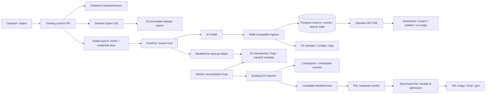

# W&B-Compatible Training Launch and Automated Artifact Handoff Implementation Plan

## Summary

Deliver one coherent ModelFiche workflow from an immutable captioned dataset version through a live AI Toolkit run, automated S3 backup and checkpoint import, candidate model registration, FAL-ready checkpoint handoff, and subsequent image, Eval, and grid generation.

The W&B component remains a narrow compatibility shim for one pinned SDK and the exact calls made by AI Toolkit. It is not a generic W&B replacement. The surrounding launch and artifact workflow removes manual assembly and post-training S3 import work from the operator:

1. The operator publishes or selects an immutable dataset version.
2. ModelFiche creates a pending training run, publishes a reproducible dataset export, reserves the run’s S3 prefixes, and returns a copyable JSON launch manifest.
3. An agent configures AI Toolkit and a generated S3 backup helper on RunPod or another trainer host.
4. Metrics and sample images arrive live through the W&B-compatible ingress.
5. The backup helper continuously archives config, logs, and stable checkpoint files and publishes a checkpoint handoff manifest last.
6. ModelFiche automatically reconciles the bound S3 prefix, imports and verifies checkpoints, creates candidate model versions, and computes FAL readiness.
7. FAL-ready model versions become available to image generation, Evals, and grids without a manual S3 browse/import step.

The implementation must preserve separate lifecycle state for training execution, backup, checkpoint import, model registration, and FAL readiness. `run.finish()` means that training execution ended; it does not by itself assert that checkpoints are imported or usable by FAL.

## Problem Frame

ModelFiche already has several pieces of the workflow, but they are not connected end to end:

- `POST /api/datasets/{dataset_id}/drafts` clones a published `DatasetVersion` into editable `DatasetDraftItem` rows.
- Publishing a draft creates a new immutable `DatasetVersion`; published versions are never overwritten.
- Dataset-version exports are queued through the existing `export.package` job.
- `TrainingRun` can reference a `DatasetVersion`, an S3 `ImportSource`, and a remote `source_prefix`.
- The S3 importer already recognizes AI Toolkit runs, discovers checkpoints even when manifests are incomplete, creates `Checkpoint` and `CheckpointRevision` records, imports samples and metrics, and creates candidate `ModelVersion` rows.
- `POST /api/runs/{run_id}/refresh` can enqueue a bound S3 import, but an operator must trigger it.
- The FAL request resolver can generate a short-lived exact-version S3 handoff URL at request time, but current UI availability is still biased toward a persisted `fal_url`.
- The dashboard shows recent runs, the project page shows the latest run, and the sidebar has Models, Datasets, and Evals branches, but active training is not a first-class navigation state.
- The API is currently a trusted loopback operator application with no account authentication. A remote trainer cannot use its normal W&B client against the existing `TrustedLocalBoundary`.

The missing product contract is a first-class training launch resource that binds dataset version, run identity, telemetry credentials, S3 destination, backup behavior, automated reconciliation, and downstream readiness before the trainer starts.

## End-to-End User Story

### 1. Curate and publish

The operator opens a dataset, runs captioning, edits captions and inclusion state, and publishes an immutable dataset version. The version records the exact ordered assets, captions, caption format, inclusion state, tags, and trigger words used for training.

### 2. Copy or branch from immutable data

From any published version, the operator can:

- **Create new version from this version:** clone the selected version into a working draft in the same dataset. This formalizes and relabels the behavior already implemented by `POST /api/datasets/{dataset_id}/drafts`.
- **Duplicate as new dataset:** create a new dataset in the same project with a published version copied from the selected version, then optionally open a new draft. The clone reuses immutable `Asset` identities and copies dataset-item metadata; it does not duplicate image bytes.

The new version or dataset preserves explicit parent-version lineage. Cross-project cloning is out of scope until project-scoped asset ownership and authorization are defined.

### 3. Create training launch

The operator selects **Start training run** from a published dataset version and supplies run name, base model, expected trainer output directory, checkpoint policy, supported FAL endpoint preference, and a previously configured reusable W&B ingest credential. ModelFiche creates a `TrainingLaunch` and pending `TrainingRun`, queues the dataset export, binds the configured S3 source and run prefix, records the credential reference, and prepares the JSON launch manifest. Launch creation does not mint or rotate the W&B API key.

### 4. Copy launch JSON to the agent

The launch screen provides:

- **Copy launch JSON:** stable manifest that can be copied again later; it names the selected ModelFiche credential alias, signed-token claims, and `WANDB_API_KEY` environment variable but never contains a private key, signed token, or password-manager locator.
- **Download launch JSON:** same stable JSON as copy.
- **Copy environment block:** shell-compatible nonsecret W&B settings plus a command/placeholder for the agent to sign the launch claims into `WANDB_API_KEY`.

The W&B ingest credential is an Ed25519 signing identity created once per project or workspace and reused across launches until deliberately rotated or revoked. The agent generates the keypair, stores the private key in its password manager, and registers only the public key, alias, and key epoch with ModelFiche. ModelFiche never reads, writes, or calls the password manager and never possesses the private key. At launch time the agent signs the manifest’s exact credential/project/launch/run/issued-at/expiry claims and injects the resulting Base32-and-underscore token as `WANDB_API_KEY`. The pinned `wandb==0.28.0` capture proves a 294-character token restricted to letters, digits, and underscores reaches HTTP Basic authentication unchanged; dotted/base64url-style keys are rejected by the SDK. Long-lived W&B or S3 private credentials are never copied into the stable manifest.
### 5. Agent launches training

The agent downloads and verifies the dataset export, installs the pinned W&B SDK, maps the launch credential alias to an agent-owned password-manager private key, signs the launch claims into `WANDB_API_KEY`, injects backup credentials as environment secrets, installs the versioned ModelFiche backup helper, starts the helper, and starts AI Toolkit without modifying its W&B logger.

### 6. Live run

`wandb.init()` atomically binds the expected external W&B identity and changes the run from `pending` to `running`. Committed metrics, text values, summaries, and sample images appear on the live run page. Active runs are highlighted on the dashboard and project page and appear as bounded links in the expanded project sidebar.

### 7. Automated backup and checkpoint handoff

The backup helper continuously archives trainer config, logs, state markers, and stable checkpoint files under the reserved run prefix. It uploads a content-addressed checkpoint only after the local file is closed and stable, verifies the remote size, and publishes `checkpoint-handoff.v1.json` last. On clean exit it publishes a completion marker; on interruption it publishes an interrupted marker when possible.

ModelFiche polls the known prefix as the provider-neutral baseline. An S3 event/SQS webhook may accelerate reconciliation where supported, but correctness cannot depend on provider event notifications. No operator opens the generic S3 import browser or clicks Refresh in the normal path.

### 8. Automatic import and readiness

The worker detects the new handoff generation, validates its source, prefix, digest, and object inventory, invokes the existing idempotent S3 import path, creates checkpoint revisions and candidate model versions, and verifies whether each candidate has a supported FAL handoff. Current FAL adapters consume a short-lived HTTPS URL; there is usually no separate persistent upload into a FAL registry. ModelFiche therefore automates FAL-ready handoff validation and generates the exact URL only when an admitted FAL request is executed.

### 9. Evaluate

Verified FAL-ready candidate versions appear in image generation, Eval, and grid selectors. Candidate creation and FAL readiness may be automated; lifecycle approval remains an explicit operator or separately authorized agent action.

## Scope Boundaries

### In scope

- One pinned W&B SDK version and the exact protocol exercised by AI Toolkit.
- Reusable project- or workspace-scoped API-key authentication, restricted to pre-created launch run IDs, plus run bind/resume, config, scalar/text metrics, summaries, sample images/captions, heartbeat, and finish.
- Published dataset-version launch precondition.
- Clone-to-draft from any immutable version.
- Same-project dataset duplication without byte duplication.
- Copyable/downloadable stable JSON launch manifests with a ModelFiche credential alias and no W&B plaintext secret or password-manager locator.
- Reproducible dataset export publication for remote trainers.
- Versioned backup-helper configuration and agent-installable backup script/package.
- Continuous config/log/checkpoint backup to a reserved S3 prefix.
- Manifest-last, idempotent automated S3 reconciliation.
- Automatic checkpoint and checkpoint-revision import.
- Automatic candidate `ModelVersion` creation using the existing importer.
- Automatic supported-endpoint and exact-handoff readiness verification.
- Live run page plus active dashboard, project, and sidebar states.
- Postgres for the remote live-ingestion deployment while retaining local SQLite mode when the feature is disabled.
- API, CLI, UI, and agent-tool parity for all launch and recovery actions.

### Out of scope

- Full W&B GraphQL compatibility.
- Sweeps, reports, tables, artifact registries, model registries, arbitrary media, or generic W&B integrations.
- Uploading checkpoints through `wandb.Image` or W&B artifact APIs.
- Generic cloud job orchestration for RunPod or every trainer provider.
- Cross-project dataset duplication.
- Automatically approving candidate model versions.
- Automatically starting billable FAL generation after import.
- A generic FAL model registry. Adapter-specific persistent upload is added only if a supported endpoint requires it.
- Depending on AWS-only S3 event infrastructure for correctness.
- Persisting long-lived S3 secrets in Postgres, S3 manifests, logs, or activity events.

## Requirements

### Dataset versioning and copying

- **R1.** A training launch references exactly one published `DatasetVersion`; mutable drafts and ambiguous current-version pointers are rejected.
- **R2.** “Create new version from this version” clones the selected immutable version into a draft, including item order, asset ID, caption, caption format, inclusion, and tags.
- **R3.** “Duplicate as new dataset” creates a same-project dataset and immutable version using the same `Asset` IDs and copied item metadata without duplicating bytes.
- **R4.** Every new version or duplicated dataset version records explicit parent-version lineage.
- **R5.** Dataset clone/publish operations are idempotent under a client request ID and never mutate the source version.

### Launch manifest and export

- **R6.** One launch creation transaction allocates `TrainingRun`, `TrainingLaunch`, W&B external identity, S3 prefixes, and immutable dataset-version binding before any external work.
- **R7.** The existing export worker produces a deterministic dataset package and manifest; the launch stores its content digest and publication receipt.
- **R8.** The dataset export is published to managed S3 or another trainer-reachable immutable location and exposed through a short-lived exact read capability.
- **R9.** The stable redacted launch manifest is persistable, copyable, downloadable, and safe to show again.
- **R10.** A reusable W&B ingest credential is configured once per project or workspace, persisted by ModelFiche only as an authentication verifier, stored as plaintext by the operator or agent in an external password manager, referenced by a ModelFiche alias in launches, and rotated or revoked only deliberately rather than recreated for every run.
- **R11.** Copy JSON, download JSON, copy environment, CLI JSON, and agent-tool responses use the same versioned schema.
- **R12.** Launch packets include checksums, expirations, expected SDK version, expected run identity, dataset export identity, backup profile, S3 prefix, and recovery instructions.

### W&B compatibility

- **R13.** Pin exactly `wandb==0.28.0` initially; the pin may change only with regenerated captures and a passing compatibility suite.
- **R14.** Implement only operations and response shapes observed in the protocol-capture suite.
- **R15.** Support API-key auth, idempotent create/resume, project/run-name mapping, full sanitized config capture, batched history, step commits, summary updates, scalar/text metrics, image metadata/captions, upload instructions, heartbeats, and finish.
- **R16.** Reject unsupported operations explicitly instead of returning fabricated success.
- **R17.** Duplicate batches, out-of-order steps, run reconnection, repeated finish, and transient server failures preserve training continuity under the pinned SDK.

### Live state and navigation

- **R18.** The run detail shows status, current step, actual primary-loss metric name/value, learning rate, elapsed time, last event, graph, samples, captions, steps, and upload state.
- **R19.** Dashboard active runs are separated from recent runs and remain visible until terminal transition.
- **R20.** The project page shows active runs separately from the latest completed run.
- **R21.** The expanded project sidebar shows at most three active run links and a remainder count without loading full run history for collapsed projects.
- **R22.** Support multiple simultaneous active runs; do not assume one active run per project or workspace.

### Automated S3 backup

- **R23.** Launch allocates a server-owned run prefix and never trusts a client-selected bucket or arbitrary final prefix.
- **R24.** The backup helper reads credentials only from configured environment variables or a supported temporary-credential source; it never writes secrets to its manifest or logs.
- **R25.** The helper archives sanitized launch/config data, trainer config, bounded logs, trainer state, and completed checkpoints; W&B-owned sample upload is not redundantly copied by default.
- **R26.** A checkpoint is eligible only after local size/mtime stability or an explicit trainer save-complete hook, local SHA-256 calculation, remote size verification, and manifest inclusion.
- **R27.** The helper uses content-addressed or generation-fenced keys and publishes the handoff manifest last so the DAM never treats an in-progress file as committed.
- **R28.** Large checkpoint transfer may use the S3 client’s multipart implementation; completion is still represented only by the final immutable manifest generation.
- **R29.** The helper publishes backup heartbeat and completed/interrupted markers when possible; missing markers remain recoverable through DAM heartbeat and object reconciliation.

### Automatic reconciliation and import

- **R30.** Training launch pre-binds `origin_source_id`, immutable source fingerprint, and `source_prefix`; no name-based source guessing occurs after launch.
- **R31.** The worker polls due active/completed launches using persisted `next_reconcile_at`; provider events may only move this time earlier.
- **R32.** W&B finish schedules immediate reconciliation without assuming the backup helper has already completed.
- **R33.** Reconciliation validates the handoff schema, generation, run ID, dataset version, object keys, sizes, digests, and allowed prefix before import.
- **R34.** The current S3 importer remains authoritative for asset/checkpoint/sample/config discovery and observed-object reconciliation; a second checkpoint importer is prohibited.
- **R35.** Repeated or overlapping reconciliation creates no duplicate runs, checkpoints, revisions, assets, samples, models, or model versions.
- **R36.** Missing final markers, incomplete uploads, changed object versions, and checksum mismatch produce explicit recoverable or terminal artifact states without changing the completed training status.

### Model registration and FAL readiness

- **R37.** Successful checkpoint import invokes the existing candidate `ModelVersion` reconciliation, carrying base model, trigger words, run, dataset-version, checkpoint-step, and immutable revision lineage.
- **R38.** Candidate creation is automatic; approval is not.
- **R39.** FAL readiness is a stable typed projection such as `unavailable|verifying|ready|blocked`, with endpoint ID and handoff mode; no expiring signed URL is persisted.
- **R40.** Exact versioned S3 or an explicitly validated public immutable URL can make a supported model version FAL-ready.
- **R41.** The FAL request resolver generates the short-lived checkpoint URL at admitted execution time.
- **R42.** Image, Eval, and grid selectors use the typed readiness projection rather than requiring a persisted `fal_url`.
- **R43.** If an adapter later requires provider-side persistent upload, it must implement a dedicated adapter job and receipt; this is not inferred for current URL-based adapters.

### Reliability and security

- **R44.** Training execution status, backup status, checkpoint-handoff status, import status, model lifecycle, and FAL readiness remain separate.
- **R45.** A reusable W&B signing credential is scoped to a project or workspace. Every ingress request must carry a valid signed token binding the active key epoch, credential, project, launch, and expected W&B run ID; terminal launches and cross-run/project replays are rejected. The credential cannot create arbitrary runs, mutate datasets, submit checkpoint manifests, approve models, or execute FAL jobs.
- **R46.** Checkpoint-backup credentials are prefix-scoped and separate from W&B signing credentials; callback/event credentials cannot read or write arbitrary runs.
- **R47.** Authorization headers, signed W&B tokens, private keys, temporary tokens, S3 secrets, and signed URL query strings are structurally redacted from logs, errors, events, captures, and stable manifests.
- **R48.** The remote ingress uses TLS, exact captured-query allowlisting, request/body/batch/file limits and an auth-failure throttle from first deployment, separate least-privileged Postgres/S3 identities, and no operator API exposure.
- **R49.** SSE is served by the operator API under its trusted/private/authenticated boundary, never by the public W&B ingress.
- **R50.** Postgres and S3 failures return pinned-SDK-compatible retry behavior; accepted history is acknowledged only after its database transaction commits.

## Key Technical Decisions

- **KTD1. Immutable version first.** Training can start only from a published `DatasetVersion`; a launch never follows the dataset’s mutable “current” pointer.
- **KTD2. Clone metadata, not bytes.** Draft cloning and same-project dataset duplication reuse immutable assets. Copying dataset items does not copy image objects.
- **KTD3. Explicit ancestry.** Add parent-version lineage rather than inferring version ancestry from timestamps or names.
- **KTD4. Launch is a resource.** `TrainingLaunch` owns preparation, export, reusable credential selection, backup profile, expected prefixes, and reconciliation state; it is not an unstructured JSON field on `TrainingRun`.
- **KTD5. Stable launch JSON contains public signing claims, not a secret-manager reference.** Copy/download output names the selected ModelFiche credential alias, public key epoch, exact launch claims, and environment variable. The agent owns the alias-to-private-key mapping; ModelFiche has no password-manager access or private key.
- **KTD6. W&B credentials are asymmetric integration resources.** Configure one reusable project- or workspace-scoped Ed25519 signing identity, persist only its public key/epoch and display alias in ModelFiche, and rotate it only for compromise or planned policy. The agent creates a replayable run-scoped signed token for each trainer process; it does not create or store another long-lived credential.
- **KTD7. Manifest-last backup.** The agent may upload throughout training, but only a final immutable handoff manifest generation admits checkpoint import.
- **KTD8. Polling is canonical.** Prefix polling works across AWS S3 and S3-compatible providers. Notifications accelerate but never establish correctness.
- **KTD9. Extend the existing importer.** `SQLAlchemyImportSink._finalize_run` and `_reconcile_model` remain the checkpoint/model import path. Automated launch reconciliation invokes them instead of duplicating them.
- **KTD10. No generic FAL upload assumption.** Current adapters consume a URL. ModelFiche verifies handoff capability and creates short-lived URLs at execution time rather than copying every checkpoint into an undefined FAL registry.
- **KTD11. Candidate is automatic; approval is explicit.** Import may create candidates and make them FAL-ready, but never silently promotes them.
- **KTD12. Lifecycle dimensions are orthogonal.** Training completion cannot conceal pending or failed checkpoint backup/import.
- **KTD13. W&B is pinned and narrow.** Protocol captures, not general W&B documentation, define the ingress.
- **KTD14. Public ingress is isolated.** A separate ASGI app/process and least-privileged credentials avoid weakening `TrustedLocalBoundary` for operator routes.
- **KTD15. Local mode remains local.** Existing SQLite/local operation continues when remote W&B ingestion is disabled; the remote multi-process deployment requires Postgres.

## High-Level Architecture



## Lifecycle Model

### Training execution

```text
pending -> running -> completed
                   -> failed
                   -> interrupted -> running
```

### Launch preparation

```text
preparing_export -> ready -> issued
                 -> blocked
```

### Backup

```text
not_started -> active -> completed
                      -> interrupted
                      -> failed
```

### Checkpoint handoff

```text
awaiting_manifest -> manifest_observed -> verifying -> imported
                                              |      -> partial
                                              -> failed
```

### Model and FAL

```text
checkpoint imported -> candidate model version -> FAL verifying -> FAL ready
                                               -> FAL blocked
candidate -> approved | archived
```

A completed training run may legitimately show `checkpoint handoff: awaiting_manifest`. A FAL-ready candidate may remain unapproved. UI and API responses must expose these states independently.

## Persistence Changes

### `dataset_versions`

Add:

- `parent_version_id`, nullable self-FK with `SET NULL`.
- `lineage_kind`: `initial|version|dataset_clone|import`.
- Optional immutable content/manifest digest if not already represented by the export receipt.

Publishing a draft copies `DatasetDraft.base_version_id` into `parent_version_id`. Duplicating a dataset sets the new version’s parent to the selected source version.

### `training_runs`

Extend with W&B/live projections:

- `wandb_run_id`
- `wandb_project`
- `wandb_display_name`
- `wandb_sdk_version`
- `wandb_protocol_revision`
- `current_step`
- `started_at`
- `finished_at`
- `last_event_at`
- `exit_code`

Continue using:

- `dataset_version_id` for immutable launch input.
- `origin_source_id`, source fingerprint, and `source_prefix` for automated S3 reconciliation.
- `normalized_config` and sanitized `raw_state` for config/protocol state.
- `status` only for training execution.

### `wandb_ingest_credentials`

Add a reusable ModelFiche integration credential resource:

- `id`
- workspace ID
- optional project ID; project scope is the default and workspace scope is explicit
- unique display alias used by launch manifests
- signing algorithm/version
- active key ID/rotation epoch
- Ed25519 public key
- active/revoked state
- created, rotated, revoked, and last-used timestamps

Credential setup is agent-initiated: the agent generates an Ed25519 keypair, stores the private key in its password manager, and registers only the public key and alias with ModelFiche. Launch manifests expose canonical claims for `credential_id`, `kid`, workspace/project, launch ID, expected W&B run ID, issued-at, and expiry. The agent signs those claims and encodes the payload/signature using only SDK-accepted letters, digits, and underscores. Ingress verifies signature, scope, active key epoch, and nonterminal launch state on every GraphQL, filestream, and upload-instruction request, not only at init. Tokens remain replayable for the same run so SDK retries and reconnects work; expiry must cover the expected run duration because the SDK does not reread `WANDB_API_KEY` mid-run. A reconnect after expiry requires the agent to sign a replacement token with the same stored private key. Rotation advances `kid` and immediately rejects tokens from superseded epochs.
### `training_launches`

Add a one-to-one launch resource:

- `id`
- `run_id`, unique FK
- `dataset_version_id`
- `state`
- `client_request_id`, unique within workspace
- `manifest_version`
- `redacted_manifest`
- `manifest_digest`
- `dataset_export_job_id`
- `dataset_export_asset_id` or publication locator/receipt
- `source_id` and immutable source fingerprint
- `run_prefix`
- `backup_policy`
- `checkpoint_policy`
- `supported_endpoint_ids`
- `wandb_credential_id`, FK to the reusable ingest credential
- credential binding/last-validation timestamps for this launch identity
- `backup_status`
- `checkpoint_handoff_status`
- `next_reconcile_at`
- `reconcile_generation`
- latest reconciliation error/timestamps

Plaintext credentials are never stored.

### `training_metrics`

Reuse the existing logical metric table and uniqueness `(run_id, step, name)`. Add nullable text storage and value type while retaining numeric values and the existing `(run_id, name, step)` index.

### `run_metric_summaries`

Add one row per run and metric name with latest step/value/type, numeric minimum/maximum, and update time. This is the only latest-metric cache; do not duplicate latest loss and learning-rate columns on `TrainingRun`.

### `run_events`

Add durable ordered events for run start/resume/status, metric commits/corrections, sample pending/uploaded/failed, backup state, handoff state, checkpoint import, model candidate creation, and FAL readiness. SDK heartbeats update `last_event_at` without inserting an event every interval.

### `run_uploads`

Add a narrow W&B file-session record for sample/config/log presigning and media correlation. It is not a second asset registry. Once verified, normal `Asset`, `AssetLocation`, and `Sample` records are created.

### `run_artifact_handoffs`

Add a generation-fenced record:

- `run_id`
- `generation`
- `manifest_key`
- manifest ETag/version/digest
- state
- observed source fingerprint
- checkpoint count
- verified/imported/failed counts
- error and timestamps

Unique `(run_id, generation)` and manifest-version identity make polling and provider-event races idempotent.

### Existing entities retained

- `Checkpoint` and `CheckpointRevision` remain authoritative checkpoint identity.
- `ModelVersion` remains one intentionally usable candidate per checkpoint.
- `Asset` and `AssetLocation` remain byte and storage identity.
- Existing `Job`, `ImportJob`, publication/transfer, and activity records remain the durable work/audit primitives.

## S3 Layout

```text
projects/{project_id}/runs/{run_id}/
  launch/
    launch-manifest.redacted.v1.json
  samples/
  configs/
    ai-toolkit-config.yaml
    wandb-config.json
  logs/
  checkpoints/
    {stage-or-default}/
      step-{step}-{sha12}.safetensors
  manifests/
    checkpoint-handoff.v1.generation-{n}.json
  state/
    backup-heartbeat.json
    training-complete.json
    training-interrupted.json
```

Dataset exports are content-addressed separately so several launches can reuse the same immutable export:
ModelFiche creates a launch atomically, queues the deterministic export, selects an existing reusable W&B credential, and records the backup destination. Preparation is a state machine; it is not complete merely because the database rows exist.

The UI/API exposes:

- Copy launch JSON.
- Download launch JSON.
- Copy environment block with secret placeholders.

## Versioned Launch Manifest

### Redacted stable document

```json
{
  "schema_version": "modelfiche.training-launch.v1",
  "launch_id": "launch-uuid",
  "run": {
    "id": "run-uuid",
    "name": "portrait-lora-v4",
    "project_id": "project-uuid",
    "dataset_version_id": "dataset-version-uuid",
    "trainer": "ai-toolkit",
    "base_model": "FLUX.1-dev"
  },
  "dataset": {
    "export_id": "asset-or-receipt-id",
    "sha256": "...",
    "size": 123,
    "download_capability_required": true
  },
  "telemetry": {
    "sdk": "wandb",
    "sdk_version": "0.28.0",
    "base_url": "https://dam.example.com",
    "entity": "dam",
    "project": "portrait-lora",
    "run_id": "expected-wandb-id",
    "resume": "allow",
    "api_key_environment": "WANDB_API_KEY",
    "credential_alias": "portrait-lora-wandb",
    "token": {
      "format": "MF1_BASE32_ED25519",
      "kid": "credential-epoch-1",
      "claims_version": 1,
      "expires_at": "2026-07-20T00:00:00Z"
    }
  },
  "backup": {
    "helper_version": "1",
    "source_directory": "/workspace/output",
    "destination_prefix": "projects/project-uuid/runs/run-uuid/",
    "credential_environment": {
      "access_key": "MODELFICHE_S3_ACCESS_KEY",
      "secret_key": "MODELFICHE_S3_SECRET_KEY"
    }
  },
  "artifact_handoff": {
    "checkpoint_prefix": "projects/project-uuid/runs/run-uuid/checkpoints/",
    "manifest_callback_url": "https://dam.example.com/api/runs/run-uuid/checkpoint-handoffs",
    "manifest_token_environment": "MODELFICHE_HANDOFF_TOKEN"
  }
}
```

The stable launch output never contains a W&B bearer token, private key, or external secret-manager locator. `credential_alias`, `kid`, and token claims identify public ModelFiche launch state. The agent owns the private mapping from the alias to its password-manager signing key and exposes only the derived signed token as `WANDB_API_KEY`.
### Agent-owned password-manager contract

Project/workspace integration settings provide **Register W&B signing credential**, **Test**, **Rotate**, and **Revoke** actions. The agent generates and stores the Ed25519 private key under its own password-manager naming and access policy, then sends only the public key and alias to ModelFiche. ModelFiche has no password-manager credentials and never attempts to resolve or persist the private key. Launches select the reusable signing identity and include only public signing claims. Losing a launch manifest never rotates the credential. Losing or compromising the private key invokes explicit rotation, advances `kid`, and revokes every token signed under the previous epoch.
### Clipboard behavior

- Use the browser Clipboard API only from a user gesture.
- Show copied/failed status in an accessible live region.
- Never copy automatically.
- Provide a textarea/manual fallback when clipboard permission is denied.
- Never put secret JSON in the URL, local storage, browser history, analytics, or error reports.

## Dataset Copy Semantics

### New version from selected version

Reuse the existing draft clone endpoint and make the source version explicit in the UI. The version strip allows selecting any immutable version, then choosing **Create new version from this version**. Draft creation copies dataset-item metadata and records the base version.

### Duplicate as new dataset

Add:

```text
POST /api/dataset-versions/{version_id}/duplicate-dataset
```

Body:

```json
{
  "name": "Portrait LoRA — alternate crop",
  "description": "Forked for square crops",
  "client_request_id": "uuid",
  "open_draft": true
}
```

Behavior:

1. Validate source version and same-project destination.
2. Create a new `Dataset`.
3. Create immutable version 1 using the same asset IDs and copied item metadata.
4. Set `parent_version_id` and lineage kind.
5. Optionally create a draft from version 1.
6. Record activity and lineage.
7. Return existing resource IDs on an idempotent replay.

No S3 copy occurs. If future cross-project duplication is added, it must define whether project-owned assets are shared or published into new project-owned revisions.

## Backup Helper Contract

Implement a small versioned `modelfiche-run-sync` Python entrypoint or standalone package that the agent installs on the trainer host. It is mechanical infrastructure, not an AI component.

### Inputs

- Launch manifest path.
- Trainer output directory.
- S3 endpoint, region, bucket, and addressing mode.
- Credential environment variable names.
- Checkpoint globs and optional stage mapping.
- Sync and stability intervals.

### Behavior

1. Refuse a manifest whose schema, run identity, destination prefix, or helper version is unsupported.
2. Refuse credentials embedded in ordinary manifest fields.
3. Periodically upload bounded config and log updates.
4. Detect checkpoint candidates only after an explicit save-complete hook or unchanged size/mtime across two configured scans.
5. Calculate SHA-256 locally.
6. Upload using the S3 client’s safe multipart behavior when needed.
7. HEAD the object and verify size; include ETag/version where available.
8. Write the checkpoint handoff manifest to a generation-specific key only after every referenced checkpoint upload is complete.
9. Update a small backup heartbeat object without rewriting immutable artifact keys.
10. On normal process completion, publish a completion state object after the handoff manifest.
11. On signal/exception, attempt an interrupted state object without claiming incomplete files.
12. Redact credentials and signed URLs from all output.

### Agent setup

The copyable launch JSON includes deterministic setup instructions or a helper command, not an unreviewed generated shell program containing secrets. The agent may wrap the helper in a RunPod startup/exit script, systemd unit, supervisor, or container entrypoint. ModelFiche supplies a tested reference wrapper and checksum.

## Automatic Reconciliation

### Trigger model

Canonical triggers:

- Due-launch maintenance scan using `next_reconcile_at`.
- Immediate scheduling on W&B finish.
- Immediate scheduling when a valid optional S3-event callback identifies the exact bound source/prefix.
- Operator/agent **Retry reconciliation** action after a blocked state.

Provider events are hints only. The worker always verifies the current bound source and object state.

### Worker flow

1. Claim one due launch using compare-and-set on reconcile generation/time.
2. Re-read launch, run, source fingerprint, run prefix, and feature gate.
3. Observe state and manifest keys under the allowed prefix.
4. If no manifest is present, update backup/handoff projections and schedule bounded backoff.
5. If a new manifest generation is present, persist `RunArtifactHandoff` before external reads.
6. Fetch and validate the bounded manifest.
7. HEAD every referenced checkpoint and compare immutable version/ETag, size, and digest evidence.
8. Invoke the existing S3 import job for the exact run prefix and project.
9. Let `SQLAlchemyImportSink` reconcile observed assets, config, metrics, samples, checkpoints, revisions, and model candidates.
10. Verify imported checkpoint/revision counts against the manifest.
11. Mark imported, partial, or failed without changing the training execution’s terminal state.
12. Enqueue FAL readiness verification for imported candidate model versions.
13. Emit run events and activity records.

### Scheduling

Extend the existing worker loop with a bounded maintenance callback that enqueues due reconciliation work. Do not create another daemon. Network I/O remains inside claimed jobs, not the maintenance scan. Backoff is persisted on `TrainingLaunch`; worker restart resumes from Postgres.

### Incomplete and changed artifacts

- An object omitted from the immutable manifest is ignored by that generation.
- A changed object version under the same key creates a new observation/revision only through existing revision rules; it cannot mutate a prior `CheckpointRevision`.
- A manifest checksum mismatch is terminal for that generation.
- A missing object is recoverable until upload grace expires, then failed.
- A later manifest generation may repair a partial handoff without deleting prior verified lineage.

## FAL Readiness Automation

### Important boundary

Current supported FAL adapters accept LoRA paths/URLs. The existing resolver already generates a ten-minute exact-version S3 URL when a verified versioned checkpoint location is available. Therefore “upload to FAL” is implemented initially as automatic FAL-ready handoff verification, not as an unnecessary persistent copy into a generic FAL registry.

### Readiness verifier

For each candidate model version:

1. Resolve the immutable checkpoint revision and asset location.
2. Determine supported endpoint from explicit launch preference or the existing supported-base-model mapping; reject ambiguous inference.
3. Verify source active state, exact S3 version ID, allowed prefix, and HTTPS-presign capability, or validate an explicit immutable public HTTPS URL.
4. Store only stable readiness metadata:
   - status
   - endpoint ID
   - handoff mode
   - verified checkpoint revision ID
   - verified source/location ID
   - verification time and redacted failure
5. Do not store a presigned URL.
6. Project the readiness through `/api/model-versions`.
7. Update generator/Eval/grid selection to use typed readiness.
8. Generate the actual URL during FAL admission/execution via `SQLAlchemyFalRequestResolver`.

### Adapter-specific persistent upload

If a future endpoint requires a provider-side upload, add a dedicated adapter capability and durable upload receipt. The job must be idempotent, checkpoint-revision-bound, and nonbillable or explicitly acknowledged. It must not reuse the W&B upload surface or silently mark readiness from a submission attempt.

## Realtime and Active UI

### Run page

Show separate cards for:

- Training execution.
- Live metrics.
- Samples and upload states.
- Backup state and last backup heartbeat.
- Checkpoint handoff/import progress.
- Candidate model versions and FAL readiness.

### Dashboard

Partition `running` runs into an **Active training** section above **Recent runs**. Show run, project, step, loss, last event, sample previews, backup status, and interruption warnings. Terminal runs move into recent history without disappearing abruptly.

### Project page

Show **Active training runs** separately from **Latest completed training run**. Preserve both because a new experiment must not hide the latest usable completed model.

### Sidebar

For an expanded project, load only active runs and show at most three compact links plus a remainder count. Historical runs remain in the runs workspace. Collapsed projects do not eager-load run collections.

### SSE

Use durable `run_events` and `Last-Event-ID` replay for the run page. A lightweight project/workspace status stream or bounded refresh updates dashboard/project/sidebar state; do not open one metric-heavy SSE connection for every sidebar run. SSE stays on the operator application boundary and requires the same private/upstream-authenticated access as the rest of the UI.

## Public Ingress and Authentication

- Run W&B endpoints in a separate FastAPI app/process.
- Route only protocol-captured W&B paths to it.
- Store only the reusable credential alias, Ed25519 public key, and active `kid`; the agent owns the password-manager mapping and private key.
- Decode and verify the signed token’s signature, credential, project, launch, run, epoch, and expiry on every ingress request. Reject terminal launches and cross-run/project replay.
- Match GraphQL by a canonical digest of the exact captured query document plus validated variable schema, never by `operationName` alone. Bound bodies before JSON parsing and throttle repeated failed authentication from the first remotely reachable deployment.
- Use separate least-privileged Postgres and S3 identities and safe server-owned S3 object keys constrained to the run prefix.
- Redact authorization headers and presign query strings from access/error logs.
- Require Postgres when the remote ingress is enabled; preserve existing local SQLite mode when disabled.

## Implementation Units

### U1. Capture and freeze the W&B 0.28.0 protocol

**Dependencies:** none.

**Files:**

- Add compatibility dependency group/lock for `wandb==0.28.0`.
- Add `tests/compat/wandb/0.28.0/` recorder and sanitized fixtures.
- Add protocol contract documentation under the same test fixture root or `docs/`.

**Changes:**

- Capture canonical and exact AI Toolkit init/log/commit/image/finish flows.
- Capture create, resume, duplicate, out-of-order, transient error, upload retry, heartbeat, finish, and unsupported operations.
- Freeze endpoint/operation allowlists, payloads, required responses, auth shape, upload headers, and retry semantics.

**Tests:**

- Canonical script completes against recorder.
- Exact AI Toolkit logger completes.
- Fixture sanitization removes tokens and signed URLs.
- Unknown operation receives the documented explicit error.

**Covers:** R13–R17, R47–R50.

### U2. Add launch, event, metric-summary, upload, and handoff persistence

**Dependencies:** U1 protocol fields frozen.

**Files:**

- Modify `apps/api/titles_api/models.py`.
- Add ordered Alembic migrations after current head.
- Modify `apps/api/titles_api/schemas.py`.
- Add focused migration/model tests.
- Add Postgres integration configuration and driver.

**Changes:**

- Add parent dataset-version lineage.
- Add training launch, summaries, events, W&B upload sessions, and artifact handoff records.
- Extend metrics for text.
- Add run W&B/live fields and constraints.
- Add dialect-safe indexes/JSON behavior and real Postgres tests.

**Tests:**

- Upgrade current schema on SQLite fixtures and Postgres.
- Assert uniqueness, FK behavior, state constraints, and idempotency keys.
- Concurrent launch/token bind and handoff-generation tests.

**Covers:** R1–R17, R30–R50.

### U3. Make immutable dataset copying explicit

**Dependencies:** U2 parent-version schema.

**Files:**

- Modify `apps/api/titles_api/routers/datasets.py`.
- Modify dataset schemas.
- Modify `apps/web/src/screens-assets.tsx`.
- Modify CLI dataset commands/client.
- Add API, web, and CLI tests.

**Changes:**

- Relabel existing draft clone as **Create new version from this version**.
- Allow any selected immutable version as base.
- Add same-project duplicate-dataset endpoint and UI.
- Reuse asset IDs; copy item metadata; record lineage and activity.

**Tests:**

- Source version is byte/row unchanged.
- Draft/version clone preserves exact metadata.
- Dataset duplicate creates no new Asset or AssetLocation.
- Cross-project request is rejected.
- Client-request replay returns the same duplicate.

**Covers:** R1–R5.

### U4. Implement training launch and copyable JSON

**Dependencies:** U2, U3, existing export job.

**Files:**

- Add training-launch router/service modules.
- Modify `apps/worker/titles_worker/export_jobs.py` or add a focused dataset-export publication handler.
- Modify integration settings, dataset/run screens, and API client.
- Add CLI launch commands.
- Add agent-tool contract tests.

**Changes:**

- Create run/launch atomically from a published dataset version.
- Queue deterministic dataset export and publish it to immutable trainer-readable storage.
- Allocate W&B identity, select an existing reusable W&B signing credential, bind backup profile/source/prefix, and record checkpoint policy.
- Return one stable launch-manifest projection containing the credential alias, public token claims, and environment/signing placeholder but no signed token, private key, or password-manager locator.
- Add Copy JSON, Download JSON, Copy environment, credential selection/status, and blocked-state recovery; credential public-key registration/test/rotate/revoke lives in integration settings rather than launch creation.

**Tests:**

- Draft launch rejected.
- Same client request returns one launch/run/export.
- Clipboard fallback and accessibility behavior.
- Private key and signed token absent after reload and from redacted endpoint/log/activity/database/S3.
- Two launches reuse the same configured signing credential/private key without registering or storing another long-lived credential; their derived tokens are launch-scoped and not interchangeable.
- Wrong signature, scope, launch, run, expired token, superseded `kid`, and terminal-launch replay are rejected.
- Export digest and download capability match exact dataset version.

**Covers:** R6–R12, R23–R24, R45–R48.

### U5. Implement minimum W&B ingress and live metrics

**Dependencies:** U1, U2, U4.

**Files:**

- Add `apps/api/titles_api/integrations/wandb/` protocol/auth/ingest modules.
- Add separate ingress entrypoint and explicit supervisor/deployment wiring.
- Factor shared metric persistence from `integrations/s3/sqlalchemy_sink.py`.
- Modify run read APIs.
- Add ingress/API tests.

**Changes:**

- Implement only captured operations for init/resume/config/history/summary/heartbeat/finish and mandatory baseline files.
- Authenticate and bind the prepared launch.
- Persist numeric/text metrics, summaries, status, and events.
- Enforce duplicate/out-of-order/reconnect/repeated-finish invariants.

**Tests:**

- Real pinned SDK against Postgres.
- Config, metrics, step, resume, repeated finish, and transient failure assertions.
- Least-privileged DB-role negative tests.

**Covers:** R13–R17, R30–R35, R44–R50.

### U6. Add run SSE and active navigation surfaces

**Dependencies:** U2, U5 event contract.

**Files:**

- Add run-event SSE router/service and tests.
- Modify `apps/web/src/screens-assets.tsx`, `screens-core.tsx`, `screens-wireframe.tsx`, `shell.tsx`, and focused styles/tests.
- Add a dedicated event hook/reducer.

**Changes:**

- Render live run status/metrics/samples.
- Add dashboard Active training.
- Add project Active training runs while retaining latest completed.
- Add bounded active-run sidebar links.
- Add backup, handoff, import, candidate, and FAL readiness projections.

**Tests:**

- Ordered replay/reconnect/reset.
- Live chart and status without reload.
- Multiple active runs and bounded sidebar behavior.
- Running to completed/interrupted transitions.
- Unauthenticated public-ingress path cannot reach SSE.

**Covers:** R18–R22, R44, R49.

### U7. Implement W&B sample upload

**Dependencies:** U1, U2, U5.

**Files:**

- Add W&B upload/media correlation service.
- Reuse S3 client/publication conventions.
- Modify run sample projections and UI.
- Add S3 compatibility tests.

**Changes:**

- Return captured presigned upload response.
- Correlate image metadata and file uploads in either order.
- Verify S3 object, create Asset/AssetLocation/Sample, persist caption/step, and emit events.

**Tests:**

- Real `wandb.Image` against test S3.
- Metadata-first/upload-first, retry, expired URL, lost notification, restart, duplicate, and prefix-escape tests.

**Covers:** R15–R17, R18, R23, R45–R50.

### U8. Build the trainer backup helper

**Dependencies:** U4 manifest contract and storage policy.

**Files:**

- Add a versioned helper package/entrypoint and focused tests.
- Add reference RunPod wrapper without secrets.
- Add helper artifact publication/checksum to release tooling.

**Changes:**

- Parse launch manifest, scan stable outputs, hash/upload checkpoints, sync config/logs, publish heartbeat, generation manifest, and terminal markers.
- Use environment-only credentials and safe multipart behavior.
- Support resume and repeated invocation without duplicate keys/manifests.

**Tests:**

- File grows during scan and is not admitted.
- Restart resumes transfer.
- Large multipart checkpoint.
- Wrong prefix/schema/run rejected.
- Manifest published only after all referenced objects verify.
- Signal writes interrupted marker without claiming partial files.
- No secret appears in helper output.

**Covers:** R23–R29, R45–R48.

### U9. Automate S3 reconciliation and checkpoint import

**Dependencies:** U2, U4, U8, existing importer.

**Files:**

- Add focused worker reconciliation handler/service.
- Extend worker maintenance scan and registration.
- Modify existing import admission only where needed to target a prepared run deterministically.
- Add worker/API/UI recovery tests.

**Changes:**

- Persist due time/generation and enqueue exact bound-prefix reconciliation.
- Trigger on finish/provider hint/manual retry.
- Validate manifest then invoke existing S3 importer.
- Compare imported results and update separate handoff/import states.
- Remove the normal-path requirement for manual run refresh.

**Tests:**

- Poll-only provider completes end to end.
- Provider event and poll race create one handoff/import.
- Manifest missing/incomplete/changed/mismatched.
- Importer restart and repeated import.
- Incomplete top-level checkpoint inventory still reconciles observed safetensors objects.
- Training remains completed while artifact import is partial/failed.

**Covers:** R30–R36, R44–R50.

### U10. Automate candidate registration and FAL readiness

**Dependencies:** U9 and exact checkpoint revisions.

**Files:**

- Factor/extend `_reconcile_model` in `integrations/s3/sqlalchemy_sink.py`.
- Add FAL readiness verifier/service and worker handler.
- Modify model-version DTOs and `generation.ts` availability logic.
- Add model, resolver, generation, Eval, and grid tests.

**Changes:**

- Preserve automatic candidate model/version creation.
- Carry trigger words/base model/lineage from launch.
- Verify supported endpoint and exact handoff without storing signed URL.
- Project typed readiness and enable selectors accordingly.
- Continue creating the short-lived URL at FAL request execution.

**Tests:**

- Exact versioned S3 candidate becomes ready.
- Missing version/source/prefix/endpoint becomes blocked with redacted reason.
- No signed URL persists.
- Candidate appears in image/Eval/grid selector when ready.
- Import does not approve candidate or submit billable work.

**Covers:** R37–R43, R44–R50.

### U11. Hardening, compatibility, and rollout

**Dependencies:** U1–U10.

**Files:**

- Add full compatibility/fault/security tests.
- Add capability/health projections and operational documentation.
- Update CLI specification/README only where required by shipped commands.

**Changes:**

- Rate/concurrency/body limits, redaction, stale-run interruption, upload/reconciliation recovery, protocol fingerprint CI, operational metrics, deployment and rollback runbooks.
- Keep remote ingress and automated production launch behind disabled feature gates until receipts pass.

**Tests:**

- Full canonical and exact AI Toolkit compatibility flow.
- Dataset clone -> launch -> live metrics/sample -> backup -> automatic checkpoint import -> candidate -> FAL-ready -> dry-run admission.
- Postgres, S3, worker, ingress, and trainer-helper crash/fault matrix.
- Credential leakage and cross-prefix/table denial tests.
- SDK pin change fails CI until captures and compatibility results change together.

**Covers:** all requirements.

## Subagent Orchestration

All project subagents must use the OpenAI Codex runtime. The parent owns contracts, shared hot files, migration order, integration, and final verification. Delegated files do not overlap.

### Wave A: discovery

Run in parallel:

- `WandbProtocolCapture`: recorder and golden fixtures only.
- `WandbSourceVerifier`: read-only pinned SDK source verification.
- `AIToolkitContractProbe`: exact logger calls, paths, loss keys, and media behavior.
- `TrainingBackupArchaeology`: read-only mapping of current external backup script/config if it is supplied to the repository or session.
- `IngressThreatModel`: read-only public-ingress, token, S3, and callback review.

Parent freezes W&B, launch-manifest, backup-manifest, event-envelope, and service contracts.

### Parent prerequisite

Parent lands or owns changes to:

- `models.py`
- Alembic migrations
- common schemas
- `pyproject.toml`/lock
- application/supervisor wiring
- versioned manifest schemas
- shared storage/import service interfaces

### Wave B: launch and telemetry

Run in parallel after frozen contracts:

- Dataset clone API/UI/CLI.
- Launch manifest/export API/UI/CLI.
- W&B ingress protocol/auth.
- Shared metric ingest service.
- SSE/read projections.
- Active dashboard/project/sidebar frontend.

### Wave C: samples, backup, and automated import

Run in parallel:

- W&B sample upload service.
- Trainer backup helper.
- Reconciliation worker.
- Backup/handoff UI.
- Image compatibility integration test.

### Wave D: candidate/FAL readiness and hardening

Run in parallel:

- Model candidate/readiness service.
- Generation/Eval/grid readiness callers.
- Fault matrix.
- Security/rate/redaction hardening.
- Protocol fingerprint CI.

### Review wave

Read-only correctness, reliability, security, API-contract, testing, maintainability, performance, and agent-native reviewers run in parallel. Parent resolves findings and runs each focused suite once.

## Compatibility and End-to-End Tests

### W&B compatibility test

Run the exact requested canonical W&B script and exact AI Toolkit commit pattern against real ingress, Postgres, and S3. Assert run/config/metrics/sample/caption/step/status and object existence.

### Training launch journey

1. Create project and dataset.
2. Publish version 1.
3. Clone a draft from version 1 and publish version 2.
4. Duplicate version 2 as a same-project dataset and prove no new asset bytes.
5. Create a launch from version 2.
6. Copy stable JSON; the agent maps its credential alias to the privately configured password-manager item and injects the resolved W&B key.
7. Download and verify dataset export.
8. Start pinned W&B client and backup helper.
9. Observe active run across dashboard/project/sidebar and live run page.
10. Upload checkpoint and handoff manifest through helper.
11. Finish W&B run.
12. Worker automatically imports checkpoint without manual refresh.
13. Candidate model version is created and FAL readiness verified.
14. Candidate becomes selectable for a dry-run image/Eval/grid admission.
15. Candidate remains unapproved and no billable FAL job is submitted automatically.

### Failure matrix

- Duplicate launch request.
- Missing launch manifest is recovered by copying it again without rotating the reusable W&B credential; explicit credential revoke/rotation behavior is tested separately.
- Dataset export publication failure.
- W&B temporary 429/503.
- Duplicate/out-of-order history.
- Ingress restart.
- Backup helper restart and stale local file.
- Multipart interruption.
- Missing handoff manifest.
- Manifest references missing/wrong-size/wrong-digest/out-of-prefix object.
- Poll/event race.
- Import worker restart.
- Repeated import/handoff generation.
- FAL source unavailable or not exactly versioned.
- Run finish before backup finish.
- Missing finish with backup interrupted marker.
- Token/callback cross-run attempt.
- Secret and signed-URL log inspection.

## Rollout and Gates

Feature gates:

```text
training_launch_contract
wandb_ingress
wandb_samples
trainer_backup_helper
automatic_run_reconciliation
automatic_fal_readiness
```

Enablement order:

1. Migrations and read projections.
2. Dataset clone and launch preparation with ingress disabled.
3. Protocol-captured scalar telemetry in nonproduction.
4. Live UI.
5. Samples.
6. Backup helper and automatic reconciliation in shadow/compare mode against manual refresh.
7. Automatic candidate/readiness in shadow mode.
8. Security/fault receipts.
9. Production ingress and automation.

During shadow mode, automated reconciliation computes and reports intended imports but does not commit them; compare with the current manual import result. Production enablement requires identical checkpoint/sample/model outcomes across representative runs.

Rollback disables new producers and ingress but preserves all accepted run, event, upload, handoff, checkpoint, revision, and model lineage. It must never delete S3 backups or roll the database behind an accepted external effect.

## Success Criteria

The feature is complete when:

- An operator can create a new editable version from any immutable dataset version.
- An operator can duplicate a version into a same-project dataset without copying image bytes.
- A published dataset version can produce a deterministic remote training export and copyable JSON launch manifest.
- An agent can set up AI Toolkit and S3 backup entirely from versioned launch outputs plus agent-owned secret mappings.
- Multiple launches reuse one agent-owned private signing key without registering another long-lived credential; each derived W&B token is launch-scoped, and unprepared, terminal, or cross-project/run requests are rejected.
- Running status, metrics, loss graph, samples, captions, and upload state appear live.
- Active runs are highlighted on dashboard and project and linked in the sidebar.
- Config/log/checkpoint backup proceeds without operator action.
- A manifest-last S3 handoff automatically triggers idempotent checkpoint import.
- Checkpoint revisions and candidate model versions are created with exact run/dataset lineage.
- Supported candidates become FAL-ready without persisting an expiring URL or requiring manual import.
- Ready candidates appear in image, Eval, and grid selectors.
- No candidate is silently approved and no billable FAL work starts automatically.
- Duplicate batches, uploads, manifests, reconciliation, finish calls, and restarts do not duplicate domain records.
- Completed, failed, interrupted, backup, import, and readiness states remain accurate and independent.
- Changing the W&B SDK pin fails CI until the protocol fixtures and full compatibility suite are deliberately updated.

## Source References

- AI Toolkit W&B logger: <https://github.com/ostris/ai-toolkit/blob/main/toolkit/logging_aitk.py>
- AI Toolkit training metric/commit flow: <https://github.com/ostris/ai-toolkit/blob/main/jobs/process/BaseSDTrainProcess.py>
- W&B 0.28.0 run mutation: <https://github.com/wandb/wandb/blob/v0.28.0/core/api/graphql/mutation_run.graphql>
- W&B 0.28.0 run-file upload mutation: <https://github.com/wandb/wandb/blob/v0.28.0/core/api/graphql/mutation_create_run_files.graphql>
- W&B 0.28.0 filestream implementation: <https://github.com/wandb/wandb/blob/v0.28.0/wandb/sdk/internal/file_stream.py>
- Existing dataset cloning: `apps/api/titles_api/routers/datasets.py`
- Existing dataset export: `apps/worker/titles_worker/export_jobs.py`
- Existing run import/checkpoint/model reconciliation: `apps/api/titles_api/integrations/s3/sqlalchemy_sink.py`
- Existing FAL exact checkpoint handoff: `apps/worker/titles_worker/fal_request_resolver.py`
- Existing active/recent project and dashboard surfaces: `apps/web/src/screens-core.tsx`, `screens-wireframe.tsx`, and `shell.tsx`
